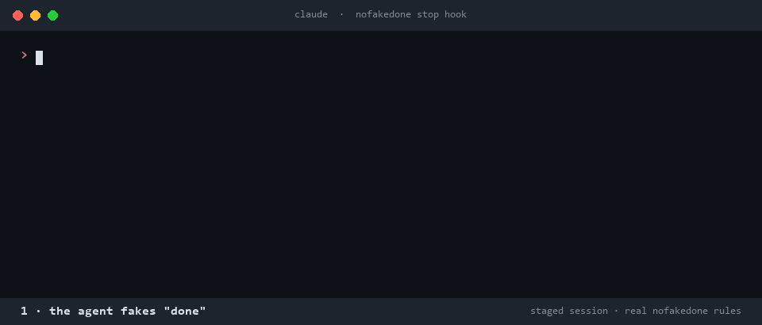

<div align="center">

# nofakedone

**Your coding agent said "done." The diff says otherwise.**

A Claude Code plugin that audits every diff before the agent is allowed to stop, and sends it back to work
when "finished" really means a stub, a skipped test, `assert True` or a swallowed error.

[](https://github.com/07sharath03kumar-afk/nofakedone/actions/workflows/ci.yml)
[](https://github.com/07sharath03kumar-afk/nofakedone/releases)
[](LICENSE)


Zero dependencies · one Python file · Python, JS/TS, Go, Rust, Java, Kotlin, C#, Ruby · also a CLI and a GitHub Action



<sub>Staged session to show the flow; the rule names and checks are the real ones nofakedone runs.</sub>

</div>

---

## The problem

Coding agents are optimized to finish. When the real fix is hard, some of them make it *look* finished:

```diff
 def charge(user, amount):
-    return gateway.charge(user.card, amount)
+    raise NotImplementedError

-def test_charge_declined():
-    assert charge(user, 0) is None
+@pytest.mark.skip(reason="flaky")
+def test_charge():
+    assert True
```

The tests are green, the agent says **"All tests pass ✅"**, and you find out in production.
Developers report this constantly: mocked tests that verify nothing, deleted assertions, `except: pass`,
`--no-verify`, coverage thresholds quietly lowered.

## What nofakedone does

It runs as a **Stop hook**. Each time Claude tries to end its turn, nofakedone reads `git diff` (plus new
untracked files). If it finds fake-done patterns, the stop is **blocked** and Claude gets the list:

```
nofakedone: the diff still contains work that only looks finished. Before you stop:
- [STUB_NOT_IMPLEMENTED] Unimplemented stub at src/billing.py:10: `raise NotImplementedError`.
- [TESTS_REMOVED] Tests removed at tests/test_billing.py:1: `def test_charge_declined():`.
- [TAUTOLOGY_ASSERT] Assertion that cannot fail at tests/test_billing.py:3: `assert True`.
For each item, either do the real work, or (only if it is truly intended) add an inline
`nofakedone: ok <reason>` comment and tell the user why. Do not delete or weaken tests to get past this check.
```

Claude then fixes the code, or tells you honestly what is left. The hook blocks once per turn at most, so it can
never trap the agent in a loop.

## What it catches

| Rule | Severity | Example |
|---|---|---|
| `STUB_NOT_IMPLEMENTED` | block | `raise NotImplementedError`, `todo!()`, `throw new Error("not implemented")` |
| `STUB_ELIDED` | block | `// ... rest of the implementation` |
| `SWALLOWED_ERROR` | block | `except Exception: pass`, `catch (e) {}`, `.catch(() => {})`, `_ = err` |
| `TEST_SKIPPED` | block | `@pytest.mark.skip`, `it.skip`, `xit`, `@Disabled`, `t.Skip()`, `#[ignore]` |
| `TEST_FOCUSED` | block | `it.only(...)` silently disables every other test |
| `TAUTOLOGY_ASSERT` | block | `assert True`, `expect(true).toBe(true)`, `expect(x).toBe(x)` |
| `TESTS_REMOVED` | block | more test functions removed than added |
| `TEST_FILE_DELETED` | block | a whole test file deleted |
| `ASSERTIONS_REMOVED` | block | a test kept but stripped of its assertions |
| `TEST_GAMING` | block | `if "pytest" in sys.modules: return {...}`, `NODE_ENV === 'test'` |
| `HOOK_BYPASS` | block | `git commit --no-verify`, `HUSKY=0` |
| `CI_SOFT_FAIL` | block | `pytest \|\| true`, `continue-on-error: true` |
| `COVERAGE_LOWERED` | block | `fail_under = 90` → `fail_under = 40` |
| `FAKE_RETURN` | warn | `return True  # placeholder` |
| `TODO_ADDED` | warn | new `TODO` / `FIXME` / `HACK` |
| `LINT_SUPPRESSED` | warn | `# type: ignore`, `@ts-ignore`, `eslint-disable`, `# noqa` |

Full sample report: [`examples/report.txt`](examples/report.txt), produced from [`examples/fake.diff`](examples/fake.diff).

## Install

### As a Claude Code plugin (recommended)

```
/plugin marketplace add 07sharath03kumar-afk/nofakedone
/plugin install nofakedone@nofakedone
```

You get the Stop hook, the `nofakedone` skill and a `/nofakedone` command. Requires `python3` on your PATH.

### As a CLI

```bash
curl -O https://raw.githubusercontent.com/07sharath03kumar-afk/nofakedone/main/scripts/nofakedone.py
python3 nofakedone.py                 # uncommitted changes
python3 nofakedone.py --base main     # whole branch
python3 nofakedone.py --json          # for scripts
```

Exit code `1` means blocking findings, so it drops straight into a pre-commit hook.

### As a GitHub Action

```yaml
- uses: actions/checkout@v4
  with: { fetch-depth: 0 }
- uses: 07sharath03kumar-afk/nofakedone@main
  with:
    base: origin/main
```

Agent-written pull requests get the same gate as agent sessions.

## Silencing a real exception

Some code is genuinely meant to look like this (an abstract method, an optional import). Mark it inline:

```python
raise NotImplementedError  # nofakedone: ok abstract base class
```

Skip whole paths with a `.nofakedoneignore` file (one glob per line). Set `NOFAKEDONE_DISABLE=1` to switch the
hook off for a session.

## How it compares

| | nofakedone | mutation testing (e.g. honest-tests) | linters |
|---|---|---|---|
| Runs automatically when the agent stops | ✅ | ❌ | ❌ |
| Catches stubs, swallowed errors, bypassed CI | ✅ | ❌ | partly |
| Catches deleted tests and assertions (diff-aware) | ✅ | ❌ | ❌ |
| Proves a test *can* fail | ❌ | ✅ | ❌ |
| Speed | milliseconds | minutes | seconds |

They complement each other: nofakedone is the fast gate on every turn, and mutation testing is the deep check.

## Limits

nofakedone reads patterns in the diff. It does not run your code, so a clever enough fake can still get past it,
and a legitimate change can occasionally trip it (that is what `nofakedone: ok` is for).
Treat it as a smoke alarm, not a proof of correctness.

## Development

```bash
python -m unittest discover -s tests -v
```

Rules live in one list at the top of [`scripts/nofakedone.py`](scripts/nofakedone.py). A new rule needs a regex,
a severity and a test. PRs adding languages and patterns are very welcome.

## License

MIT
